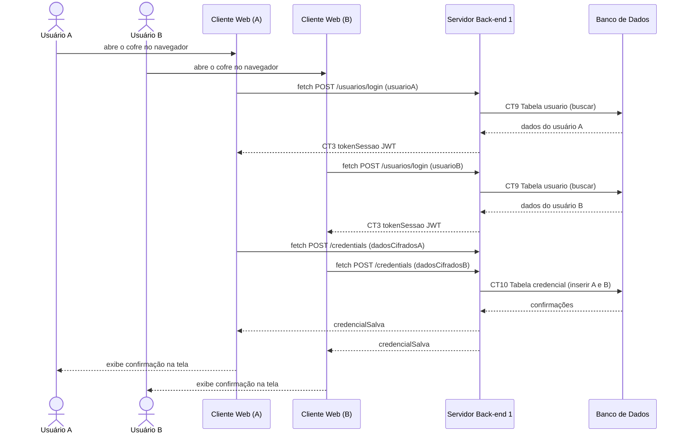

# Fluxo do E1: Servidor multiconexão

**Feito quando (da Entrega 1):** Dois usuários abrem a aplicação web ao mesmo tempo em abas ou navegadores distintos, enviam requisições e o servidor responde aos dois de forma paralela sem travar.

## Passos

1. O Usuário A acessa a interface Web e se autentica.
2. O Usuário B acessa a interface Web em outro navegador/máquina e se autentica.
3. O Servidor Back-end 1 processa as requisições HTTP simultaneamente.
4. O Usuário A envia uma requisição via API Fetch (ex: cadastrar credencial).
5. O Servidor processa de forma concorrente sem bloquear a conexão do Usuário B.
6. O Usuário B envia uma requisição via API Fetch em paralelo.
7. O Servidor responde a ambas as requisições de forma independente.
8. Os dois Clientes Web recebem e exibem os resultados em tempo real na interface.

## Diagrama de sequência

