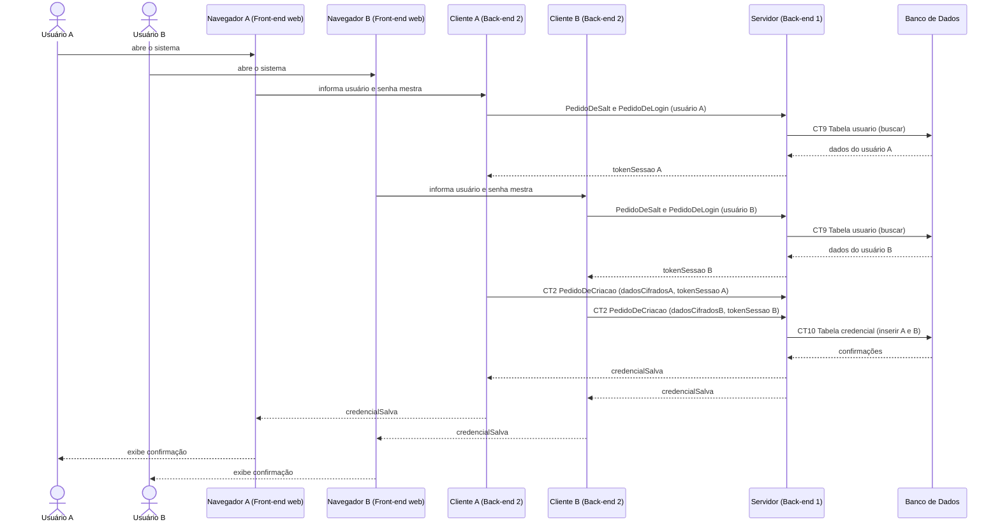

# Fluxo do E1: Servidor multiconexão

**Feito quando (da Entrega 1):** Dois usuários fazem requisições de socket ao mesmo tempo e o servidor responde aos dois de forma paralela sem travar.

## Passos

1. O Usuário A abre o sistema no navegador (Front-end web) e se autentica pelo Cliente (Back-end 2).
2. O Usuário B abre o sistema no seu navegador e se autentica pelo seu Cliente.
3. O Servidor (Back-end 1) aceita as duas conexões de socket simultaneamente.
4. O Usuário A envia uma requisição pelo navegador (ex: cadastrar credencial), e o Cliente a repassa ao Servidor via socket TCP.
5. O Servidor processa em uma thread separada, sem bloquear a conexão do Usuário B.
6. O Usuário B envia uma requisição em paralelo.
7. O Servidor responde aos dois de forma independente.
8. Os dois navegadores exibem os resultados ao mesmo tempo.

## Diagrama de sequência

