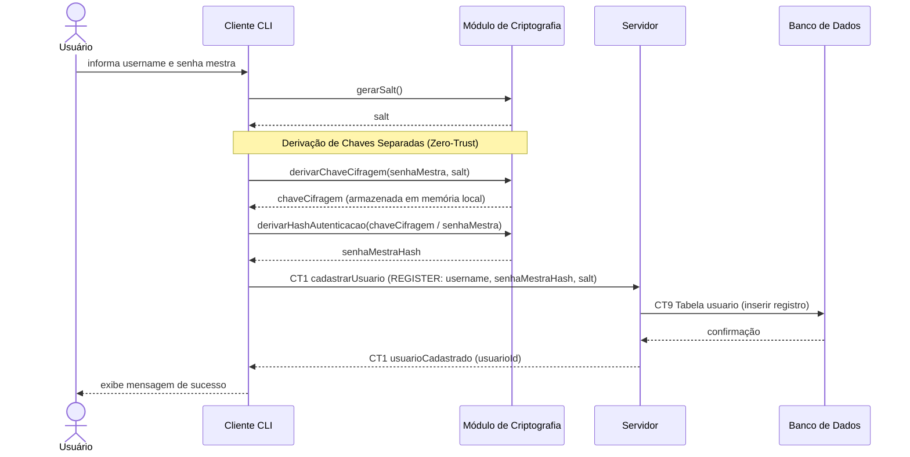

# Fluxo do E2: Cadastro de usuário

**Feito quando (da Entrega 1):** O usuário cria uma conta informando apenas um nome de usuário e uma senha mestra, e recebe a confirmação de que a conta foi criada.

## Passos

1. O Usuário informa o nome de usuário e a senha mestra no Cliente CLI.
2. O Cliente usa o Módulo de Criptografia para gerar um `salt` criptograficamente seguro (`SecureRandom`).
3. O Módulo de Criptografia deriva separadamente:
   - A **Chave de Cifragem** (mantida no cliente para cifrar o cofre).
   - O **Hash de Autenticação** (`senhaMestraHash`), função unidirecional enviada ao Servidor para validação futura.
4. O Cliente envia `username`, `senhaMestraHash` e `salt` para o Servidor via comando `REGISTER` (CT1).
5. O Servidor grava os dados na tabela `usuario` (CT9).
6. O Banco de Dados confirma a inserção.
7. O Servidor devolve a confirmação com o `usuarioId` ao Cliente.
8. O Cliente exibe a mensagem de sucesso ao Usuário.

## Diagrama de sequência

