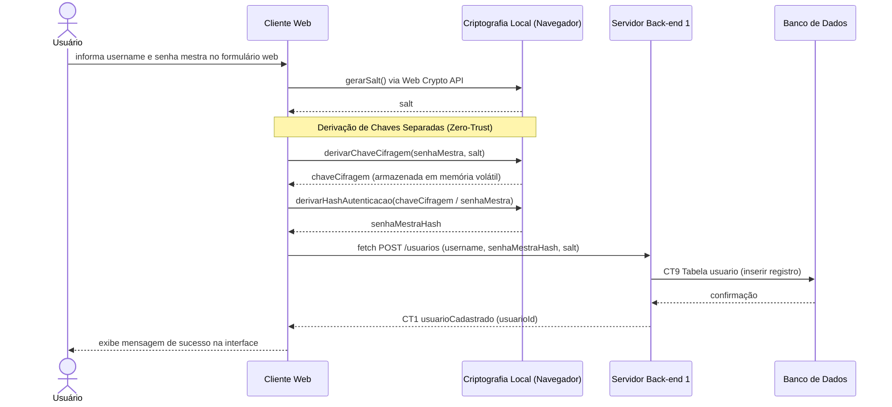

# Fluxo do E2: Cadastro de usuário

**Feito quando (da Entrega 1):** O usuário cria uma conta informando apenas um nome de usuário e uma senha mestra, e recebe a confirmação de que a conta foi criada.

## Passos

1. O Usuário informa o nome de usuário e a senha mestra na interface Web (navegador).
2. O Cliente Web gera um `salt` criptograficamente seguro via Web Crypto API (`window.crypto.getRandomValues`).
3. O Cliente deriva separadamente no navegador:
   - A **Chave de Cifragem** (mantida apenas no navegador para cifrar o cofre).
   - O **Hash de Autenticação** (`senhaMestraHash`), função unidirecional enviada ao Servidor para validação futura.
4. O Cliente Web envia `username`, `senhaMestraHash` e `salt` para o Servidor via requisição HTTP POST utilizando a API Fetch (CT1).
5. O Servidor grava os dados na tabela `usuario` (CT9).
6. O Banco de Dados confirma a inserção.
7. O Servidor devolve a confirmação com o `usuarioId` ao Cliente Web.
8. O Cliente Web exibe a mensagem de sucesso na interface do usuário.

## Diagrama de sequência

