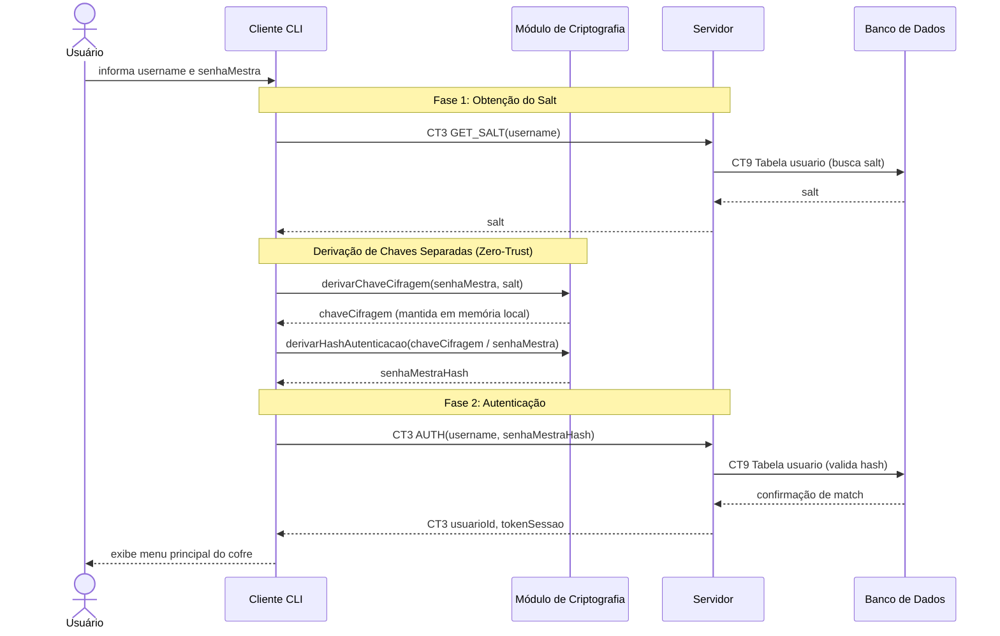

# Fluxo do E3: Autenticação

**Feito quando (da Entrega 1):** O usuário informa seu usuário e senha mestra corretos e vê o menu do cofre; se errar, vê a mensagem de erro.

## Passos

1. O Usuário informa `username` e `senhaMestra` na interface do Cliente CLI.
2. **Obtenção do Salt (Fase 1 do CT3):** O Cliente envia o comando `GET_SALT` com o `username` ao Servidor via Socket.
3. O Servidor consulta a tabela `usuario` no Banco de Dados para obter o `salt` cadastrado.
4. O Servidor devolve o `salt` ao Cliente (ou erro `USUARIO_NAO_ENCONTRADO`).
5. **Derivação de Chaves Separadas (Zero-Trust):** De posse do `salt`, o Cliente aciona o Módulo de Criptografia:
   - Deriva a **Chave de Cifragem** (usada unicamente no processo do cliente para cifrar/decifrar credenciais, mantida apenas na memória volátil).
   - Deriva o **Hash de Autenticação** (`senhaMestraHash`), obtido de forma unidirecional e isolada da chave de cifragem.
6. **Validação da Autenticação (Fase 2 do CT3):** O Cliente envia o comando `AUTH` contendo `username` e `senhaMestraHash` ao Servidor.
7. O Servidor compara o hash recebido com o armazenado na tabela `usuario`.
8. Se as credenciais forem válidas, o Servidor gera e devolve um `tokenSessao` e o `usuarioId`.
9. Se o hash não bater, o Servidor devolve o erro `SENHA_INCORRETA`.
10. O Cliente armazena o `tokenSessao` e a `Chave de Cifragem` em memória e exibe o menu do cofre ao Usuário (ou exibe a mensagem de erro correspondente).

## Diagrama de sequência

