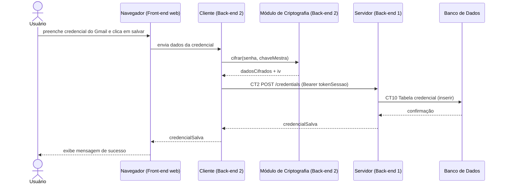

# Fluxo do E4: Salvamento de credencial cifrada

**Feito quando (da Entrega 1):** O usuário preenche os dados de um serviço (ex: Gmail), o cliente embaralha a senha e a envia ao servidor, que a guarda sem conseguir ler.

## Passos

1. O Usuário preenche o formulário com os dados da credencial do Gmail e clica em salvar no navegador (Front-end web).
2. O navegador envia os dados ao Cliente (Back-end 2), que chama o Módulo de Criptografia para cifrar a senha do serviço.
3. O Módulo de Criptografia devolve os `dadosCifrados` e o `iv`.
4. O Cliente envia `usuarioId`, `servico`, `usuarioServico`, `dadosCifrados` e `iv` ao Servidor via requisição HTTP (REST) `POST /credentials` (CT2), com o header `Authorization: Bearer tokenSessao`.
5. O Servidor valida o `tokenSessao` e grava os dados na tabela `credencial`.
6. O Banco de Dados confirma a inserção.
7. O Servidor devolve a confirmação ao Cliente, que a repassa ao navegador.
8. O navegador exibe a mensagem de sucesso.

## Diagrama de sequência

