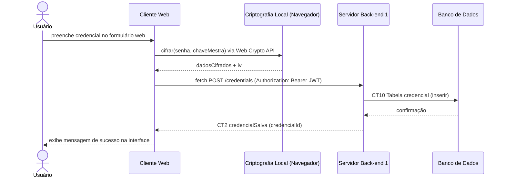

# Fluxo do E4: Salvamento de credencial cifrada

**Feito quando (da Entrega 1):** O usuário preenche os dados de um serviço (ex: Gmail) no formulário web, o cliente cifra a senha localmente no navegador e a envia ao servidor, que a armazena sem conseguir ler.

## Passos

1. O Usuário preenche os dados da credencial (serviço, usuário e senha) no formulário da interface Web.
2. O Cliente Web chama a Web Crypto API no navegador para cifrar a senha do serviço.
3. A criptografia local devolve os `dadosCifrados` e o `iv`.
4. O Cliente Web envia `servico`, `usuarioServico`, `dadosCifrados` e `iv` ao Servidor Back-end 1 via API Fetch (HTTP POST `/credentials`) com o token JWT no cabeçalho `Authorization`.
5. O Servidor valida o token JWT e grava os dados na tabela `credencial`.
6. O Banco de Dados confirma a inserção.
7. O Servidor devolve a confirmação com o `credencialId` ao Cliente Web.
8. O Cliente Web atualiza o cofre e exibe a mensagem de sucesso na interface.

## Diagrama de sequência

