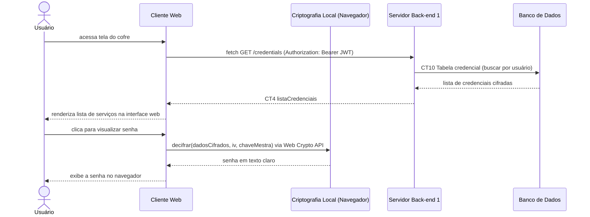

# Fluxo do E5: Consulta de credencial

**Feito quando (da Entrega 1):** O usuário pede para ver a senha do Gmail, a interface web busca os dados cifrados no servidor via API Fetch, decifra a senha localmente no navegador e a mostra em texto claro na tela.

## Passos

1. O Usuário acessa o cofre na interface Web para listar suas credenciais.
2. O Cliente Web envia a requisição de listagem ao Servidor Back-end 1 via API Fetch (`GET /credentials`).
3. O Servidor busca as credenciais do usuário na tabela `credencial`.
4. O Servidor devolve a lista com `dadosCifrados` e `iv`.
5. O Usuário clica para revelar a senha de uma credencial na interface Web.
6. O Cliente Web aciona a Web Crypto API no navegador para decifrar a senha.
7. A criptografia local devolve a senha em texto claro.
8. O Cliente Web exibe a senha na tela do Usuário.

## Diagrama de sequência

