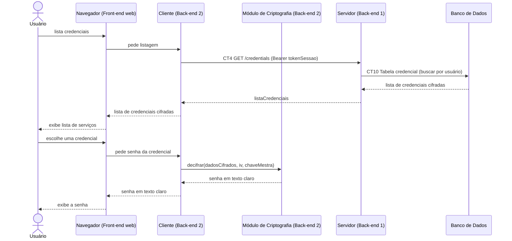

# Fluxo do E5: Consulta de credencial

**Feito quando (da Entrega 1):** O usuário pede para ver a senha do Gmail, o sistema busca no servidor, decifra a senha e a mostra em texto claro na tela.

## Passos

1. O Usuário clica em listar suas credenciais no navegador (Front-end web).
2. O navegador pede a listagem ao Cliente (Back-end 2), que envia `GET /credentials` ao Servidor via requisição HTTP (REST), com o header `Authorization: Bearer tokenSessao` (CT4).
3. O Servidor busca as credenciais do usuário na tabela `credencial`.
4. O Servidor devolve a lista com `dadosCifrados` e `iv` ao Cliente, que a repassa ao navegador.
5. O Usuário escolhe uma credencial para consultar.
6. O Cliente chama o Módulo de Criptografia para decifrar a senha.
7. O Módulo de Criptografia devolve a senha em texto claro.
8. O Cliente devolve a senha ao navegador, que a exibe para o Usuário.

## Diagrama de sequência

