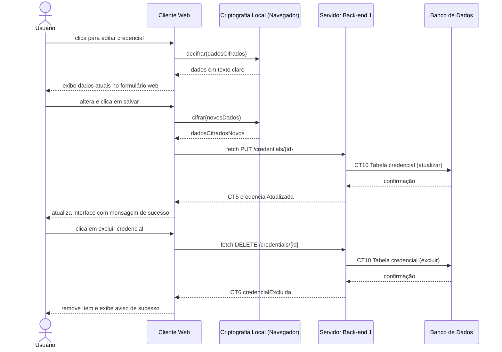

# Fluxo do E6: Edição e exclusão

**Feito quando (da Entrega 1):** O usuário gerencia credenciais no cofre via interface web. Ao editar, os novos dados são cifrados antes do envio. Ao apagar um dado, não consegue mais visualizá-lo.

## Passos

1. O Usuário visualiza as credenciais na interface Web e clica em editar em uma delas.
2. O Cliente Web decifra a credencial localmente no navegador e exibe os dados atuais no modal de edição.
3. O Usuário altera os campos desejados.
4. O Cliente Web cifra os novos dados com a Web Crypto API no navegador.
5. O Cliente Web envia os dados atualizados ao Servidor Back-end 1 via API Fetch (`PUT /credentials/{id}`).
6. O Servidor atualiza a credencial na tabela `credencial`.
7. O Banco de Dados confirma a atualização.
8. O Cliente Web exibe a confirmação de sucesso na tela.
9. (Exclusão) O Usuário clica no botão para apagar uma credencial.
10. O Cliente Web envia a requisição de exclusão via API Fetch ao Servidor (`DELETE /credentials/{id}`).
11. O Servidor remove da tabela e confirma a exclusão.
12. O Cliente Web remove o item da interface e exibe aviso de sucesso.

## Diagrama de sequência

