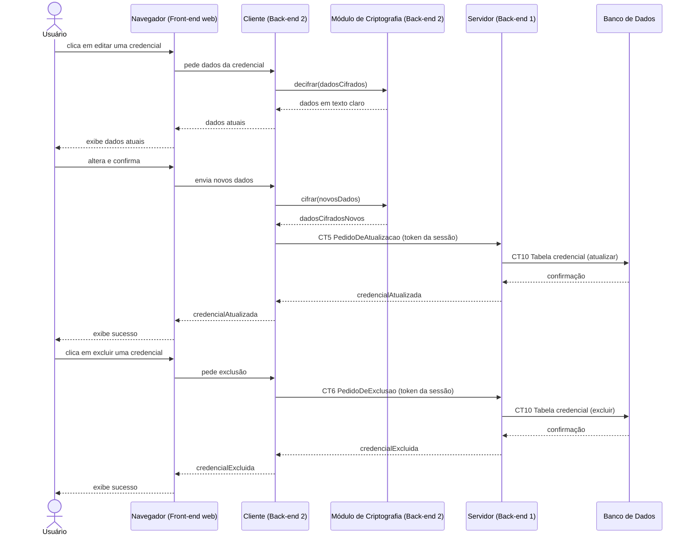

# Fluxo do E6: Edição e exclusão

**Feito quando (da Entrega 1):** O usuário cadastra dados pessoais no cofre e consegue consultá-los posteriormente. Ao apagar um dado, não consegue mais consultá-lo.

## Passos

1. O Usuário lista as credenciais no navegador (Front-end web) e clica em editar uma delas.
2. O Cliente (Back-end 2) decifra a credencial e devolve os dados atuais ao navegador, que os exibe.
3. O Usuário altera os campos que quiser no formulário.
4. O Cliente cifra os novos dados com o Módulo de Criptografia.
5. O Cliente envia os dados atualizados ao Servidor via socket TCP `PedidoDeAtualizacao` (CT5), com o header o token da sessão.
6. O Servidor atualiza a credencial na tabela `credencial`.
7. O Banco de Dados confirma a atualização.
8. O Cliente devolve a confirmação ao navegador, que exibe a mensagem de sucesso.
9. (Exclusão) O Usuário clica em excluir em uma credencial.
10. O Cliente envia `PedidoDeExclusao` (CT6) ao Servidor, com o header o token da sessão; o Servidor apaga da tabela e confirma.

## Diagrama de sequência

