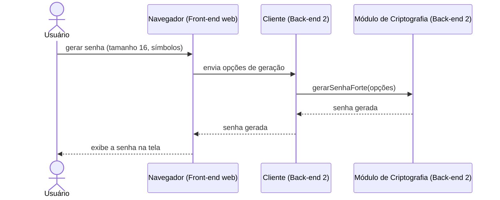

# Fluxo do E7: Gerador de senhas fortes

**Feito quando (da Entrega 1):** O usuário escolhe as opções de geração e recebe uma senha forte que pode utilizar no cadastro de uma credencial.

## Passos

1. O Usuário escolhe as opções de geração (tamanho, maiúsculas, minúsculas, números, símbolos) no navegador (Front-end web) e clica em gerar.
2. O navegador envia as opções ao Cliente (Back-end 2), que chama o Módulo de Criptografia para gerar a senha.
3. O Módulo de Criptografia gera uma senha aleatória forte com as opções escolhidas.
4. O Cliente devolve a senha ao navegador, que a exibe na tela.
5. O Usuário pode copiar a senha e usá-la em um cadastro de credencial (fluxo E4).

## Diagrama de sequência

