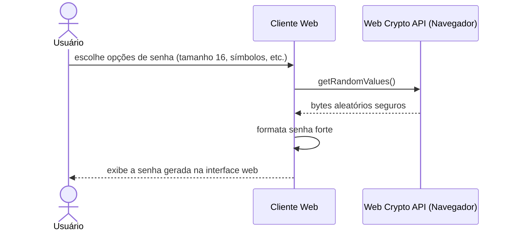

# Fluxo do E7: Gerador de senhas fortes

**Feito quando (da Entrega 1):** O usuário escolhe as opções de geração na interface web e recebe uma senha forte que pode utilizar no cadastro de uma credencial.

## Passos

1. O Usuário clica no gerador de senhas na interface Web e escolhe as opções (tamanho, maiúsculas, minúsculas, números, símbolos).
2. O Cliente Web utiliza a Web Crypto API (`window.crypto.getRandomValues`) para gerar a sequência pseudoaleatória segura.
3. A senha gerada é exibida no campo correspondente da interface.
4. O Usuário pode copiar a senha gerada com um clique ou aplicá-la diretamente no formulário de cadastro de credencial (fluxo E4).

## Diagrama de sequência

