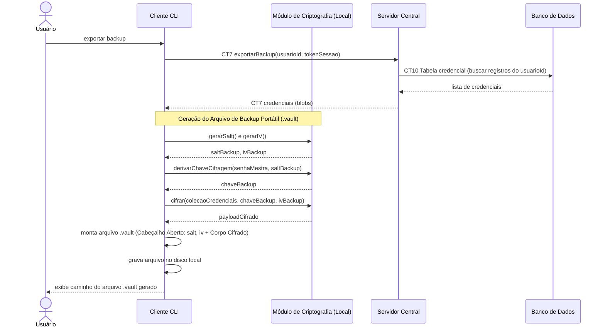

# Fluxo do E8: Backup cifrado do cofre (.vault)

**Feito quando (da Entrega 1):** O usuário exporta um arquivo de backup cifrado e portátil (`.vault`) contendo suas credenciais, conseguindo identificar o arquivo salvo em disco para uso posterior.

---

## Estrutura e Especificação do Arquivo `.vault`

Para viabilizar a portabilidade entre diferentes computadores sem depender de um banco de dados prévio, o arquivo de backup gerado possui uma **estrutura de duas camadas**:

```
+--------------------------------------------------------------------------+
| 1. CABEÇALHO ABERTO (Plaintext Header - Metadados de Inicialização)      |
|    {                                                                     |
|      "versao": "1.0",                                                    |
|      "algoritmo": "AES-256-GCM",                                         |
|      "salt": "a7f3b89c01de52...",                                        |
|      "iv": "99e1c4a03b128f...",                                          |
|      "criadoEm": "2026-10-28T11:00:00Z"                                  |
|    }                                                                     |
+--------------------------------------------------------------------------+
| 2. CORPO CIFRADO (Ciphertext Payload)                                    |
|    Payload cifrado pelo Módulo de Criptografia utilizando a chave        |
|    derivada de (senhaMestra + salt do cabeçalho) e o IV do cabeçalho.    |
|    Conteúdo interno protegido: JSON contendo a coleção de credenciais.   |
+--------------------------------------------------------------------------+
```

### Por que o Cabeçalho é Aberto?
1. **Portabilidade Universal:** O `salt` e o `iv` da camada de envelope do backup precisam ser lidos por qualquer Cliente CLI onde o arquivo seja restaurado no futuro, mesmo que o usuário esteja em uma máquina nova sem nenhum registro local pré-existente.
2. **Segurança Criptográfica (Zero-Trust):** Em conformidade com os padrões da criptografia moderna (como LUKS, OpenSSL e gerenciadores de senhas padrão de mercado), `salt` e `IV` não são segredos criptográficos; são valores públicos aleatórios destinados a prevenir ataques de dicionário (*rainbow tables*) e garantir não-repetição de blocos cifrados. Sem a **senha mestra** (que nunca sai da mente do usuário), o corpo cifrado permanece matematicamente inquebrável.

---

## Passos

1. O Usuário digita o comando para exportar o backup no Cliente CLI.
2. O Cliente envia a requisição de exportação ao Servidor via Socket (`CT7 exportarBackup`) com `usuarioId` e `tokenSessao`.
3. O Servidor valida o `tokenSessao`, consulta a tabela `credencial` (`CT10`) e devolve a lista de credenciais ao Cliente.
4. O Cliente aciona o Módulo de Criptografia (local) para:
   - Gerar um `salt` criptográfico exclusivo para o backup (`gerarSalt()`);
   - Gerar um vetor de inicialização `iv` para o pacote (`gerarIV()`);
   - Derivar a chave de cifragem do backup a partir da senha mestra e do novo `salt`;
   - Cifrar o conjunto de dados das credenciais com a chave do backup.
5. O Cliente monta o arquivo final `.vault` contendo o cabeçalho aberto (com `versao`, `algoritmo`, `salt` e `iv`) seguido do corpo cifrado.
6. O Cliente grava o arquivo no sistema de arquivos local (disco) da máquina do usuário.
7. O Cliente exibe o caminho e a confirmação do arquivo exportado com sucesso ao Usuário.

---

## Diagrama de Sequência

