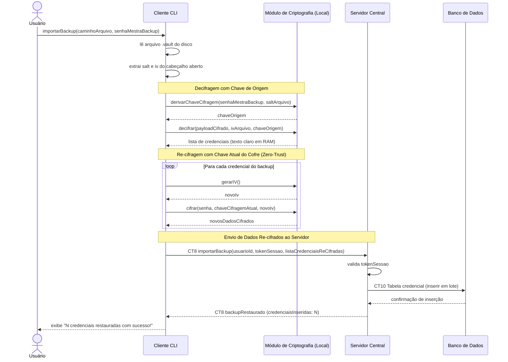

# Fluxo do E9: Restauração do backup cifrado com re-cifragem

**Feito quando (da Entrega 1):** O usuário importa um backup cifrado (`.vault`) utilizando a senha mestra correspondente ao arquivo, e as credenciais são re-cifradas com a chave atual do cofre e disponibilizadas com sucesso.

---

## Por que a Re-cifragem no Cliente é Obrigatória (Zero-Trust)?

Um arquivo de backup (`.vault`) pode ter sido gerado com uma senha mestra antiga ou pertencer a um cofre de origem com salt distinto. 
- Se as credenciais fossem enviadas ao Servidor exatamente como estavam no backup, elas ficariam **ilegíveis** no cofre atual (pois foram cifradas com uma chave diferente).
- O Servidor **não pode re-cifrar** as credenciais porque nunca possui a chave de origem, a chave atual, nem os dados em texto claro.
- **Solução Zero-Trust:** O processo do Cliente CLI decifra cada registro utilizando a **chave de origem** (derivada da senha do backup e do salt do arquivo) e **re-cifra imediatamente cada credencial com a chave mestra ativa do cofre atual** (utilizando novos IVs aleatórios) antes de enviá-las ao Servidor.

---

## Passos

1. O Usuário digita o comando para importar um backup no Cliente CLI, informando o caminho do arquivo `.vault` e a senha mestra do backup.
2. O Cliente lê o arquivo `.vault` do disco local e extrai os metadados do cabeçalho aberto (`salt` e `iv`).
3. O Cliente aciona o Módulo de Criptografia para:
   - Derivar a **chave de origem**: `chaveOrigem = derivarChaveCifragem(senhaMestraBackup, saltBackup)`;
   - Decifrar o corpo do backup com a `chaveOrigem` e o `iv` do cabeçalho.
4. Caso a senha do backup esteja errada ou os dados corrompidos, o Módulo de Criptografia falha e o Cliente cancela a operação exibindo erro `SENHA_BACKUP_INCORRETA` ou `BACKUP_CORROMPIDO`.
5. Se a decifração for bem-sucedida, o Cliente obtém a lista das credenciais em texto claro na memória volátil local.
6. **Re-cifragem individual (Zero-Trust):** Para cada credencial obtida:
   - O Módulo de Criptografia gera um novo vetor de inicialização (`novoIv = gerarIV()`);
   - O Módulo de Criptografia cifra os dados da credencial utilizando a **chave de cifragem ativa do cofre atual** (`chaveCifragemAtual`) e o `novoIv`.
7. O Cliente monta a lista de credenciais já re-cifradas com a chave atual e envia a requisição `CT8 importarBackup` ao Servidor via Socket, contendo `usuarioId`, `tokenSessao` e a lista de credenciais.
8. O Servidor valida o `tokenSessao` e insere os registros cifrados na tabela `credencial` (`CT10`).
9. O Banco de Dados confirma a gravação dos novos registros.
10. O Servidor responde ao Cliente com a confirmação e o total de `credenciaisInseridas`.
11. O Cliente exibe mensagem de sucesso ao Usuário informando quantas credenciais foram restauradas.

---

## Diagrama de Sequência

