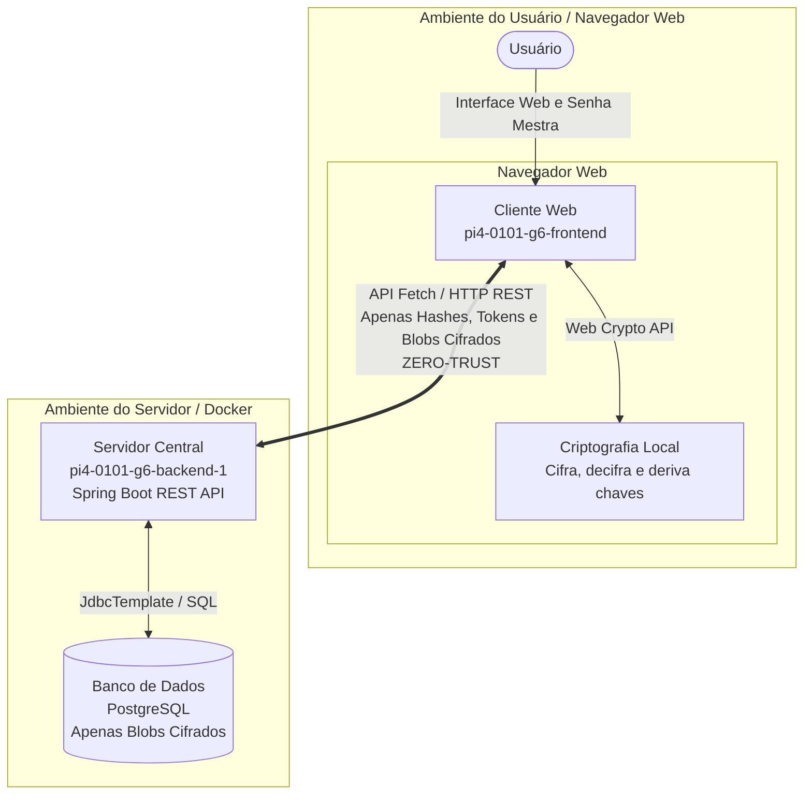

# Visão Geral — Cofre Digital

## Módulos do Sistema

| Módulo | O que faz | Tecnologia | Repositório | Responsável |
|---|---|---|---|---|
| **Cliente (Front-end Web)** | Interface Web (navegador). Interage com o usuário, orquestra operações, aciona a criptografia localmente no navegador e comunica-se com o servidor Back-end 1 via API Fetch (HTTP/REST). | HTML5, CSS3, JavaScript (Web Crypto API & Fetch API) | [pi4-0101-g6-frontend](https://github.com/egili/pi4-0101-g6-frontend) | Guilherme Heron |
| **Módulo de Criptografia (Back-end 2)** | Especificação de algoritmos e testes de referência criptográfica. Responsável pelas regras de cifrar, decifrar, derivar chaves, gerar salts, IVs e senhas fortes. | Java (JDK 17+), `javax.crypto` | [pi4-0101-g6-backend-2](https://github.com/egili/pi4-0101-g6-backend-2) | Leonardo Maciel |
| **Servidor Central (Back-end 1)** | Servidor de aplicação REST com Spring Boot. Gerencia requisições HTTP via API Fetch do cliente, autentica sessões com tokens JWT, processa requisições de CRUD e persiste dados já cifrados. Nunca tem acesso a chaves mestras ou dados em texto claro. | Java (JDK 17+), Spring Boot, JdbcTemplate | [pi4-0101-g6-backend-1](https://github.com/egili/pi4-0101-g6-backend-1) | Eliseu Gili |
| **Banco de Dados** | Armazena dados de usuários (hashes de autenticação e salts) e credenciais como blobs cifrados (`dados_cifrados` + `iv`). | PostgreSQL | Junto ao Back-end 1 | Eliseu Gili |
| **Infraestrutura** | Orquestração e conteinerização do servidor e banco de dados via containers padronizados. | Docker + Docker Compose | Junto ao Back-end 1 | Pietra Bortolato |
| **Documentação Formal** | Relatórios de ideação, cronogramas (GUT/5W2H), matriz SWOT, ADRs e especificações de contratos e fluxos. | Markdown / PDF | [pi4-2026-2-0101-grupo06](https://github.com/egili/pi4-2026-2-0101-grupo06) | Pietra Bortolato |

---

## Arquitetura Zero-Trust e Fronteiras de Segurança

O sistema opera sob o modelo **Zero-Knowledge / Zero-Trust**:
1. **Isolamento de Processo e Cifragem Local:** Todas as funções de derivação de chaves (`PBKDF2`), cifragem e decifragem (`AES-GCM`) são executadas no hardware e espaço de memória do navegador do usuário antes de qualquer envio de rede.
2. **Fronteira de Rede (API Fetch / HTTP REST):** Pela rede trafegam exclusivamente via requisições HTTP com a API Fetch:
   - Identificadores (`username`, `usuarioId`);
   - Dados públicos de derivação (`salt`, `iv`);
   - Hashes de autenticação unidirecionais (`senhaMestraHash`);
   - Tokens de sessão JWT (`tokenSessao`);
   - Cargas de dados cifradas (`dadosCifrados`).
3. **Servidor Cego a Texto Claro:** O Servidor Central (Back-end 1) e o Banco de Dados nunca recebem a senha mestra do usuário nem a chave simétrica de cifragem. Em caso de comprometimento total do servidor ou vazamento do banco de dados, os dados das credenciais permanecem matematicamente protegidos e indecifráveis.

---

## Diagrama de Contêineres (C4 — Nível 2)

---

## Convenção de Nomes

Para manter a consistência entre os módulos e o banco de dados, adotamos a seguinte convenção:
- **Mensagens entre módulos (Cliente $\leftrightarrow$ Servidor):** Utilizamos `camelCase` para nomes de campos (ex: `usuarioId`, `senhaMestraHash`, `tokenSessao`) e verbo no infinitivo seguido do objeto para rotas e operações (ex: `cadastrarUsuario`, `salvarCredencial`, `exportarBackup`).
- **Banco de Dados:** Utilizamos `snake_case` para nomes de tabelas e colunas (ex: `usuario_id`, `senha_mestra_hash`, `dados_cifrados`, `criado_em`).
- **Mensagens de Aviso/Confirmação:** O objeto seguido do evento (ex: `usuarioCadastrado`, `credencialSalva`, `backupRestaurado`).
